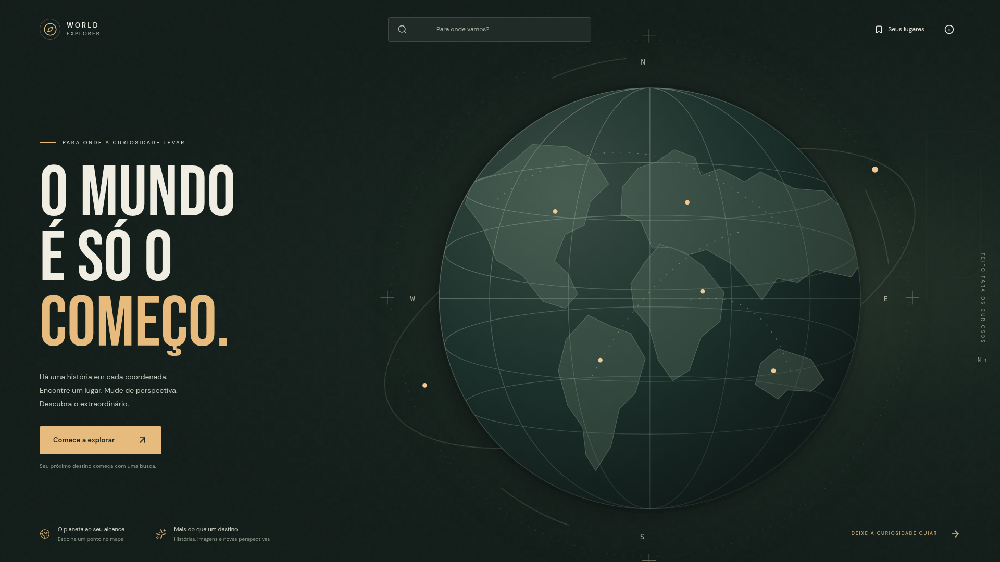
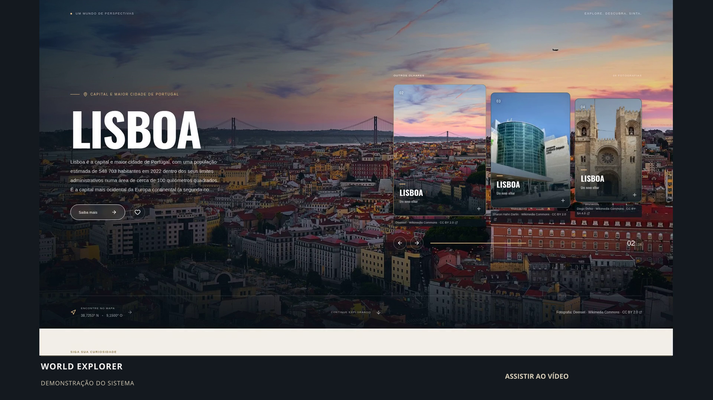
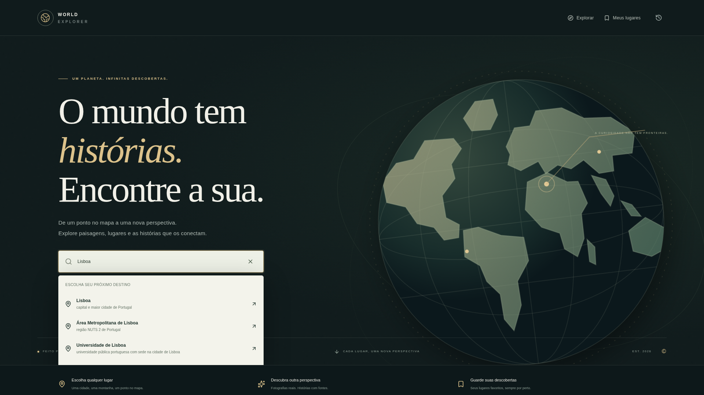
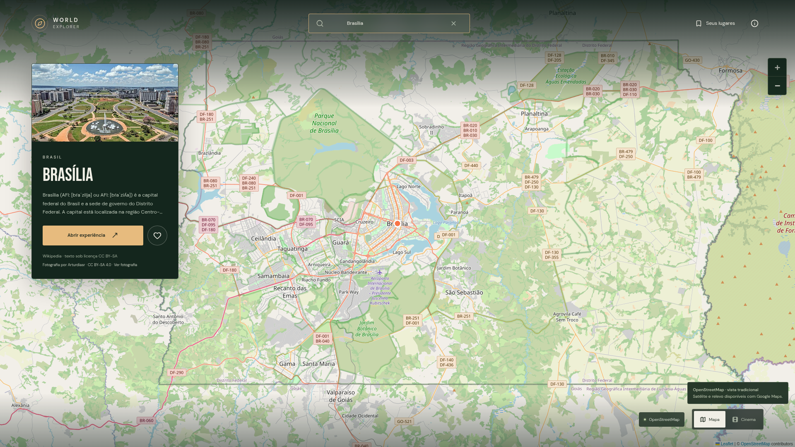
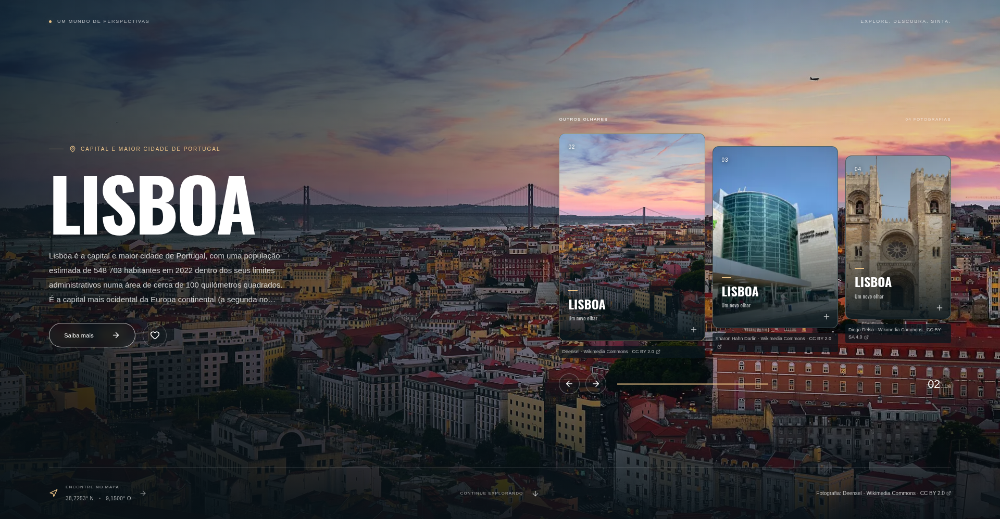
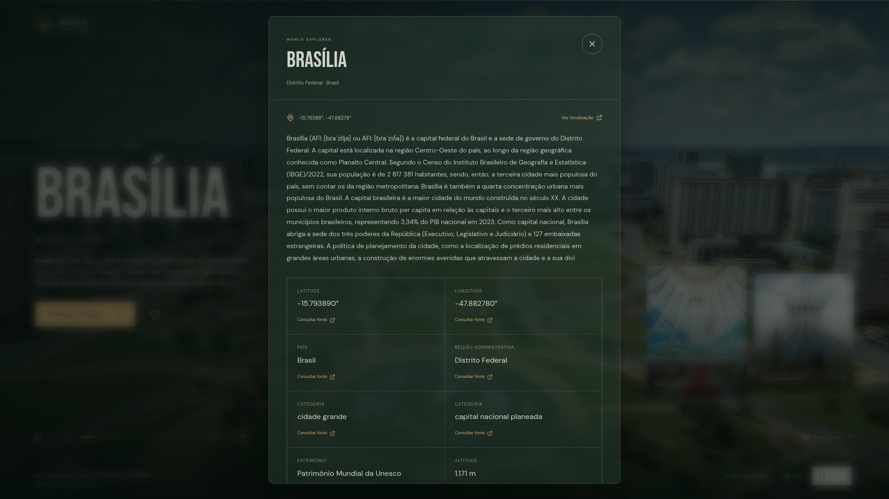
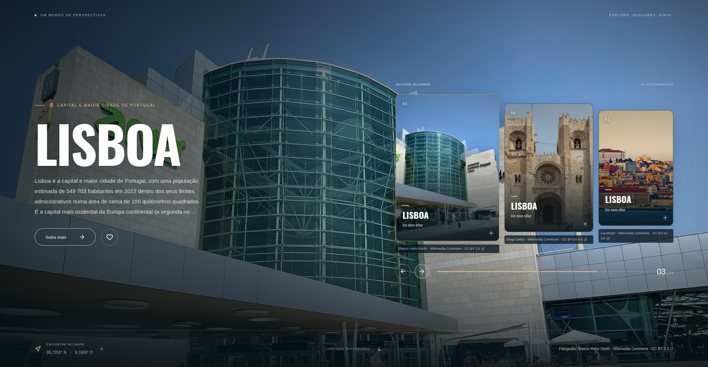
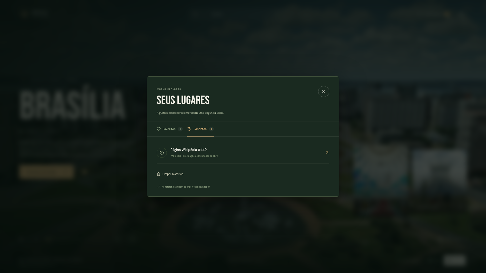
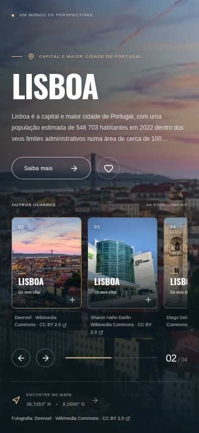

# World Explorer

Uma aplicação de exploração geográfica que conecta pesquisa, mapa interativo e uma apresentação cinematográfica do lugar escolhido. O destino é identificado pelos serviços integrados; textos, fotografias e sugestões próximas são consultados dinamicamente. Não existe um catálogo obrigatório de destinos nem fotografias aleatórias para preencher resultados ausentes.

A interface está em português. O projeto utiliza Next.js 16.4, React 19.3, TypeScript em modo estrito, Tailwind CSS 4.3, GSAP, Google Maps JavaScript API, Leaflet, Zod, Vitest e Playwright.

## Apresentação visual



## 🎬 Demonstração do Sistema

Veja uma exploração real de Brasília: pesquisa dinâmica, seleção no mapa OpenStreetMap, apresentação cinematográfica, informações com fontes, troca de fotografias, locais próximos, favoritos e histórico.

[](docs/media/video/world-explorer-demo.mp4)

**1 min 38 s · 1920 × 1080 · H.264 · 30 FPS.** O vídeo é silencioso, com explicações e legendas incorporadas em português brasileiro. Não havia uma ferramenta de narração pt-BR adequada no ambiente de produção.

[Vídeo MP4](docs/media/video/world-explorer-demo.mp4) · [Legendas SRT](docs/media/video/subtitles-pt-br.srt) · [Fontes, autores e licenças](docs/media/MEDIA_CREDITS.md) · [Como reproduzir as capturas](docs/media/README.md)

## 📸 Imagens do Sistema

Capturas do sistema funcionando com serviços públicos reais, sem respostas simuladas. Clique em uma imagem para abrir o PNG completo.

| Tela inicial | Pesquisa dinâmica |
| :---: | :---: |
| [](docs/media/screenshots/01-home.png) | [](docs/media/screenshots/02-search.png) |
| **Mapa interativo** | **Apresentação cinematográfica** |
| [](docs/media/screenshots/03-map.png) | [](docs/media/screenshots/04-cinematic.png) |
| **Detalhes e fontes** | **Galeria e locais próximos** |
| [](docs/media/screenshots/05-details.png) | [](docs/media/screenshots/06-gallery.png) |
| **Favoritos e histórico** | **Versão mobile** |
| [](docs/media/screenshots/07-favorites.png) | <a href="docs/media/screenshots/08-mobile.png"></a> |

## Funcionalidades demonstradas

- Pesquisa de localidades e seleção de resultados consultados em tempo real.
- Mapa com zoom, navegação e localização selecionada.
- Apresentação com fotografias reais, animações originais e créditos.
- Consulta de informações, fontes e lugares próximos.
- Galeria, favoritos, histórico e nova consulta ao recuperar uma referência.
- Interface adaptada a smartphones.

A demonstração foi capturada em 10 de outubro de 2026 no modo aberto, sem chaves Google, a partir do commit [14c9411](https://github.com/Helio965/Globe-Express/commit/14c94113f88692edf0eca8bf38308fc6dfdeb1b9). A disponibilidade das fotografias e dos dados depende das fontes externas. Os [créditos das mídias](docs/media/MEDIA_CREDITS.md) identificam autores e licenças individuais.

## Como funciona

1. Pesquise um lugar ou selecione coordenadas no mapa.
2. Confirme o local e abra a apresentação.
3. Consulte o resumo, as informações documentadas e suas fontes.
4. Navegue pelas fotografias disponíveis, seus créditos e licenças.
5. Explore resultados próximos ou retorne ao mapa mantendo a seleção.
6. Salve uma referência nos favoritos ou volte a um destino recente. Os dados externos são consultados novamente ao reabrir o lugar.

Sem Google configurado, o projeto usa Leaflet com cartografia OpenStreetMap e pesquisa em artigos geográficos da Wikipedia. Esse modo não oferece a mesma cobertura mundial de endereços, estabelecimentos e pontos de interesse do Google Places. Uma consulta pode não ter artigo com coordenadas; uma região remota ou oceânica pode ter apenas as coordenadas escolhidas.

Com as duas chaves Google configuradas, a aplicação utiliza Google Maps e Places API (New) para pesquisa, detalhes e lugares próximos, além de Geocoding para seleção por coordenadas. Wikipedia, Wikidata e Wikimedia Commons complementam as informações e fotografias quando houver correspondência confiável. As modalidades satélite e terreno dependem do Google Maps.

Um clique identificado pela geocodificação Google só recebe conteúdo enciclopédico quando o nome corresponde ao artigo e este fica dentro de 1 km. As coordenadas escolhidas continuam intactas. Pontos sem identidade confirmada não recebem o conteúdo de um artigo vizinho.

Não há integração obrigatória com inteligência artificial. Os textos apresentados são obtidos das fontes consultadas; ausência de documentação ou imagem é indicada na interface.

## Executar localmente

Requisitos: Node.js 22 ou superior, npm e acesso à internet para os provedores externos. O ambiente de implementação utiliza Node.js 24. Utilize o checkout existente da tarefa; não é necessário criar outro worktree.

```bash
npm ci
cp .env.example .env.local
npm run dev
```

Abra [http://localhost:3000](http://localhost:3000). O modo aberto pode ser iniciado com as variáveis Google vazias. `npm ci` preserva o lockfile; `npm install` também instala as dependências, mas deve ser usado conscientemente quando se pretende atualizar a resolução de pacotes.

Para produção:

```bash
npm run build
npm start
```

As variáveis `NEXT_PUBLIC_*` são incorporadas ao código do navegador durante o build. Refaça o build após alterá-las em uma implantação. Não publique `.env.local`, chaves privadas ou arquivos de credenciais.

O desenvolvimento permite também a origem `127.0.0.1` em `allowedDevOrigins`, necessária ao navegador de testes neste ambiente com Next.js 16.4. Se a hospedagem de desenvolvimento utilizar outro domínio, acrescente essa origem específica à configuração e reinicie o servidor.

## Variáveis de ambiente

| Variável | Utilização |
| --- | --- |
| `NEXT_PUBLIC_GOOGLE_MAPS_API_KEY` | Chave pública restrita por referenciadores HTTP, usada somente no mapa do navegador. |
| `GOOGLE_MAPS_SERVER_API_KEY` | Chave privada de servidor para Places API (New) e Geocoding API. Nunca use o prefixo `NEXT_PUBLIC_` nesta chave. |

O modo Google exige ambas as chaves. Configurar somente uma delas não habilita uma integração parcial. Não são exigidas credenciais para Wikipedia, Wikidata, Wikimedia Commons ou o mapa aberto.

## Configurar Google Cloud

1. Crie ou selecione um projeto no [Google Cloud Console](https://console.cloud.google.com/).
2. Associe uma conta de faturamento ao projeto conforme as exigências da Google Maps Platform. Consulte a [tabela de preços vigente](https://developers.google.com/maps/billing-and-pricing/pricing); não presuma que uma franquia gratuita cubra todo o uso.
3. Em **APIs e serviços → Biblioteca**, habilite **Maps JavaScript API**, **Places API (New)** e **Geocoding API**. A API Places antiga não substitui Places API (New).
4. Crie **duas chaves distintas** em **APIs e serviços → Credenciais**.
5. Na chave do navegador, escolha a restrição de aplicação **Sites / referenciadores HTTP**. Autorize apenas os endereços necessários, por exemplo `http://localhost:3000/*` para desenvolvimento e `https://seu-dominio.example/*` para produção. Restrinja a API a **Maps JavaScript API**. O navegador inevitavelmente recebe essa chave; suas restrições são essenciais.
6. Na chave do servidor, restrinja as APIs a **Places API (New)** e **Geocoding API**. Quando a hospedagem disponibilizar saída com IP fixo, restrinja a aplicação a esse IP. Em plataformas sem saída fixa, configure um proxy de saída autorizado ou outra solução suportada pelo provedor antes de aplicar uma restrição por IP. Uma restrição por referenciador HTTP não protege requisições de servidor da mesma forma.
7. Insira as chaves respectivas em `.env.local` ou nas variáveis protegidas da hospedagem. Reinicie o desenvolvimento ou gere um novo build.
8. Configure quotas por API e alertas de orçamento. Alertas notificam consumo; não garantem interrupção automática das cobranças. Revise também quotas de consultas e o monitoramento de erros.
9. Abra o mapa, confirme que o provedor Google foi ativado, pesquise um destino, selecione uma sugestão e confira o marcador e a apresentação. Teste também um clique no mapa. Erros de chave, APIs desativadas, faturamento e quota precisam ser resolvidos no projeto Cloud correspondente.

Autocomplete utiliza um token de sessão UUID para associar as sugestões à seleção e aos detalhes do lugar. Tokens não devem ser reutilizados entre sessões concluídas. A aplicação solicita campos específicos e evita persistir conteúdo Google. Não transforme respostas ou URLs temporárias de fotografias em um catálogo permanente.

Pesquisa, consultas de detalhes, mapas, fotografias, geocodificação e buscas próximas podem gerar cobrança segundo as condições vigentes. Debounce, cancelamento de consultas antigas e campos limitados reduzem chamadas desnecessárias; não eliminam a responsabilidade pelo consumo.

## Integrações e acesso à rede

| Serviço | Conteúdo e finalidade |
| --- | --- |
| Google Maps JavaScript API | Mapa no navegador, seleção e estilos disponíveis. |
| Google Places API (New) | Autocomplete, identidade e detalhes do lugar, fotografias e sugestões próximas. |
| Google Geocoding API | Identificação geográfica a partir de coordenadas. |
| Wikipedia | Pesquisa de artigos geográficos, texto enciclopédico e referências. |
| Wikidata | Identificadores e fatos estruturados associados ao artigo. |
| Wikimedia Commons | Imagens relacionadas ao destino e metadados de autoria e licença. |
| OpenStreetMap | Cartografia do modo aberto, exibida com Leaflet. |

O servidor precisa alcançar os domínios Wikimedia consultados (`pt.wikipedia.org`, `en.wikipedia.org`, `www.wikidata.org` e `commons.wikimedia.org`), além de `places.googleapis.com` e `maps.googleapis.com` no modo Google. O navegador precisa carregar as imagens de `upload.wikimedia.org` e `thumb.wikimedia.org`, os tiles de `tile.openstreetmap.org` no modo aberto e os recursos Google de `maps.googleapis.com`, `maps.gstatic.com` e `*.googleusercontent.com` no modo Google. Políticas de rede da hospedagem precisam permitir esses destinos.

Tiles públicos OpenStreetMap têm uma [política de utilização](https://operations.osmfoundation.org/policies/tiles/) própria, sem garantia de disponibilidade para tráfego elevado. Para uma implantação de maior escala, escolha um provedor de tiles apropriado e preserve a atribuição exigida.

## Organização do código

- `src/app`: páginas Next.js, estilos globais e rotas de servidor.
- `src/components`: interface, pesquisa, mapa, apresentação e navegação.
- `src/services`: adaptadores das APIs externas e composição dos dados do destino.
- `src/lib` e `src/hooks`: validação, comunicação, estado e persistência local.
- `src/types/explorer.ts`: contratos compartilhados de localização, referência, fotografia, conteúdo e resposta da API.
- Testes Vitest e Playwright: validação da lógica e dos fluxos de navegação.

O navegador não recebe a chave Google de servidor. Dados de entrada e respostas externas são validados; conteúdo externo é tratado como texto. Favoritos e histórico armazenam referências, sem copiar fotografias, descrições, nomes, endereços ou respostas Google. Referências temporárias de fotografias Google também não são persistidas.

O histórico da versão anterior (`world-explorer:history:v1`) é lido com a mesma validação quando a nova chave de recentes está ausente. Ao explorar novamente, as referências são transportadas para o novo armazenamento. Limpar o histórico impede que os registros antigos reapareçam. Os endereços `/privacidade` e `/termos` redirecionam para as páginas atuais.

Fotografias Commons são descobertas a partir da imagem principal da entidade Wikidata (`P18`), da imagem principal do artigo e da categoria Commons vinculada à entidade. O sistema não incorpora indiscriminadamente todas as ilustrações de um artigo. Os arquivos passam por verificação de metadados, licença, autoria, resolução e formato; imagens identificadas como mapas, logotipos, bandeiras ou conteúdo sintético são descartadas. A vinculação da fonte reduz associações incorretas, mas não substitui uma revisão editorial de cada fotografia.

Somente artigos Wikimedia consultados com sucesso possuem cache em memória, por 60 segundos e com limite de 64 entradas por processo. Conteúdo Google não é armazenado em cache. As respostas da API usam `Cache-Control: no-store`.

### API interna

| Rota | Operação |
| --- | --- |
| `GET /api/health` | Verifica se o servidor responde; não comprova disponibilidade dos provedores externos. |
| `GET /api/config` | Informa o provedor ativo e a presença das chaves, sem expor a chave privada. |
| `GET /api/search?q=...&sessionToken=...` | Pesquisa dinâmica; aceita de 2 a 160 caracteres. Token UUID opcional, utilizado no modo Google. |
| `GET /api/reverse?lat=...&lng=...` | Resolve um ponto; latitude deve estar entre −90 e 90, longitude entre −180 e 180. |
| `POST /api/destination` | Recebe JSON com `reference` e `sessionToken` opcional, resolve o lugar e compõe o conteúdo. |
| `GET /api/photos?name=...&width=...` | Resolve uma referência válida de fotografia Google e redireciona para o recurso autorizado; largura de 1 a 4800 pixels. |

Uma referência pode ser `{ "provider": "wikipedia", "id": "ID_DO_ARTIGO", "language": "pt" }`, `{ "provider": "google", "id": "PLACE_ID" }` ou `{ "provider": "coordinates", "lat": 0, "lng": -140 }`. IDs de artigos devem ser números positivos. Os exemplos são formatos de entrada, não resultados cadastrados.

As respostas JSON usam `{ "data": ... }`; falhas usam `{ "error": { "code": "...", "message": "..." } }`. Ao solicitar `Accept: application/x-ndjson` em `/api/destination`, a resposta é um fluxo de eventos: `location` após a resolução geográfica, `destination` após a composição e `error` quando a operação falha. A interface acompanha essas etapas reais, sem porcentagens simuladas.

Há proteção de origem e limites por IP e instância em janelas de 60 segundos: 40 consultas de pesquisa, 20 de destino/geocodificação e 120 de fotografias. Em produção, o proxy deve substituir os cabeçalhos encaminhados por valores confiáveis; para múltiplas instâncias, acrescente controle de tráfego na infraestrutura. Esses limites não substituem quotas Google nem autenticação de acesso quando necessária.

## Verificar o projeto

```bash
npm run lint
npm run typecheck
npm run test
npm run build
```

Para os testes de navegador, instale Chromium quando necessário e execute:

```bash
npx playwright install chromium
npm run test:e2e
```

A configuração usa `/usr/bin/chromium` quando ele existe; caso contrário, utiliza o navegador instalado pelo Playwright. `PLAYWRIGHT_CHROMIUM_EXECUTABLE_PATH` permite indicar outro executável. `PLAYWRIGHT_BASE_URL` permite testar um servidor já iniciado; sem essa variável, o Playwright inicia o servidor de desenvolvimento em `http://127.0.0.1:3000`.

`npm run check` reúne lint, verificação TypeScript, testes unitários e build. Os testes automatizados podem usar respostas controladas para verificar estados de erro e fluxos de interface. Essas respostas existem somente nos testes e não substituem as integrações de produção.

Para uma aceitação com dados reais, teste cidade, monumento, montanha, parque, praia, local inexistente e coordenada oceânica. Brasília, Pirâmides de Gizé, Monte Everest, Yosemite, Copacabana e Tóquio são possíveis entradas de teste, não destinos cadastrados. Verifique teclado, telas pequenas, orientação horizontal, movimento reduzido, troca rápida de destinos e retorno ao mapa.

Os testes de serviços públicos ao vivo são opcionais, porque dependem da rede e das respostas atuais dos provedores. Execute-os explicitamente:

```bash
WORLD_EXPLORER_LIVE_TESTS=1 npm test -- src/tests/open-live.test.ts
```

Para verificar a API de um servidor em execução com dados reais:

```bash
npm run test:live
```

`WORLD_EXPLORER_URL` permite indicar outra instalação. O script verifica seis destinos variados, oceano, busca inexistente e coordenadas inválidas; suas entradas são somente casos de aceitação. O workflow GitHub Actions preservado executa as verificações determinísticas e o Playwright, sem exigir credenciais ou executar esse smoke externo automaticamente.

### Validação registrada

Os testes ao vivo das fontes públicas passaram **8/8**: pesquisa e resolução de Brasília, Pirâmides de Gizé, Monte Everest, Yosemite National Park, Praia de Copacabana e Tóquio, enriquecimento de Brasília, além de ponto oceânico e pesquisa inexistente. Brasília retornou 11 informações estruturadas, 10 fotografias licenciadas e 4 resultados próximos nessa execução. A imagem principal e uma miniatura oficial de 500 pixels responderam HTTP 200 com conteúdo de imagem. Esses números refletem a consulta realizada e podem mudar conforme as fontes.

A suíte determinística registrou **138 testes aprovados** e **8 testes ao vivo ignorados** na execução padrão; estes últimos foram executados separadamente pelo comando opt-in acima. O adaptador Google possui 14 testes unitários aprovados com respostas controladas. A documentação oficial Google consultada respondeu HTTP 200.

O smoke da API também passou **9/9 verificações com dados reais**. Todos os seis destinos retornaram fotografias, autoria, licença e fontes. Oceano e busca inexistente preservaram seus resultados vazios; latitude inválida retornou HTTP 400.

`npm run check` concluiu sem erros, incluindo lint, TypeScript estrito, testes e build de produção. Os **24 testes Playwright passaram** contra esse build, sem novas tentativas: exploração contínua, galeria, mapa persistente, teclado, favoritos, migração do histórico, recuperação de erros, concorrência de consultas e telas de 320, 390 e 844 pixels. O navegador também pesquisou Brasília nos serviços reais, abriu a apresentação e os detalhes, navegou pela galeria e retornou ao mapa. Tiles OpenStreetMap e imagens Wikimedia responderam HTTP 200 com verificação HTTPS ativa; não houve erros de JavaScript, falhas de requisição ou transbordamento horizontal na tela móvel. A auditoria das dependências de produção registrou zero vulnerabilidades.

As chaves Google continuam ausentes neste ambiente. Portanto, mapa, pesquisa, geocodificação e fotografias Google **não foram validados ao vivo**. Configure as duas chaves e realize os passos de aceitação descritos acima. O acesso real a Wikimedia foi validado; o bloqueio inicial de rede foi resolvido. Implementar uma integração ou testar seu adaptador com respostas controladas não comprova a validação do provedor real.

## Limitações e falhas esperadas

- Um resultado geográfico não garante artigo, fotografias licenciadas ou atrações próximas.
- Fontes diferentes podem divergir em nomes, idiomas, atualização e precisão. Confira os links de origem antes de usar informações importantes.
- Pontos oceânicos e regiões pouco documentadas mantêm suas coordenadas e podem não gerar uma apresentação completa.
- O modo aberto depende de artigos geográficos; não equivale à cobertura de endereços e negócios do Google Places.
- Falha de um provedor deve ser informada sem criar fatos ou imagens para substituí-lo. Tente novamente após resolver rede, credenciais ou quota.
- Favoritos são locais ao navegador. Limpar os dados do site ou trocar de navegador não preserva essa coleção.
- Endpoints públicos precisam de controles de tráfego adequados à infraestrutura de produção, inclusive limites globais quando houver múltiplas instâncias.

## Privacidade, atribuições e licença

As páginas [Privacidade](src/app/privacy/page.tsx) e [Termos de uso](src/app/terms/page.tsx) explicam armazenamento local, comunicação com os provedores e atribuições. O projeto não implementa contas de usuário nem ferramentas próprias de publicidade ou análise de navegação.

Fotografias permanecem sujeitas à licença de cada arquivo. Créditos, autoria, fonte e links de licença não devem ser removidos. Wikimedia Commons inclui arquivos com licenças diferentes: confira a página de origem, requisitos de atribuição e eventuais obrigações de compartilhar adaptações pela mesma licença. Textos Wikipedia seguem a licença indicada na fonte, normalmente CC BY-SA; dados estruturados Wikidata são disponibilizados sob CC0. Conteúdo Google segue seus [termos](https://cloud.google.com/maps-platform/terms) e [políticas](https://developers.google.com/maps/documentation/places/web-service/policies), incluindo regras de apresentação, atribuição e armazenamento. A cartografia OpenStreetMap exige atribuição e observa a [ODbL](https://www.openstreetmap.org/copyright).

O código deste repositório é distribuído sob a [licença MIT](LICENSE). Essa licença não transfere direitos sobre fotografias, textos, mapas ou marcas dos provedores externos.
